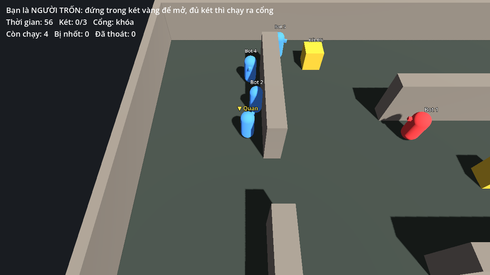

# Game Tiền Tỷ

Game rượt đuổi bất đối xứng **3D cho điện thoại**: 1 Thợ săn vs 4 Người trốn, lấy cảm hứng từ 逃跑吧!少年. Người trốn cạy rương lấy chìa khóa và nhặt tiền, đủ chìa thì 2 cổng thoát mở, ai chạy qua cổng thì người đó thắng. Thợ săn đánh gục, kéo vào tù. Kết quả tính riêng từng người.

Làm bằng Godot 4.6 (GDScript), đội 4 người.

## Dự án đang ở đâu

- **Giai đoạn hiện tại: offline.** Một người chơi với 4 bot, chọn làm Thợ săn hoặc Người trốn. Không tốn tiền server.
- **Nhưng code đã là client-server từ đầu.** Bản offline chạy đúng đường code của bản online, nên sau này lên online không phải viết lại. Chế độ tạo phòng/vào phòng qua mạng LAN đã chạy được. Lý do và cách làm: [docs/KIEN_TRUC.md](docs/KIEN_TRUC.md).
- Mục tiêu 4 tuần: một trận 1v4 offline trọn vẹn (đánh gục, kéo vào tù, cứu đồng đội, kỹ năng, bot thông minh).

Chi tiết việc đã làm và việc còn lại: mục [Tiến độ](#tiến-độ) bên dưới.

## Chơi thử

Mở thư mục này bằng Godot 4.6 rồi bấm Play.

- **Offline**: bấm "Offline: làm Thợ săn" hoặc "Offline: làm Người trốn".
- **Nhiều cửa sổ / LAN**: Debug > Customize Run Instances, bật nhiều instance. Một cửa sổ "Tạo phòng", các cửa sổ khác "Vào phòng" (IP `127.0.0.1` hoặc IP LAN của chủ phòng). Chủ phòng bấm "Bắt đầu trận".

Điều khiển: WASD / mũi tên hoặc cần trái trên màn hình, E / Space hoặc nút tròn bên phải để tương tác, chạm thẻ ở thanh dưới (hoặc phím 1-5) để dùng thẻ; thẻ ném được (túi máu, lựu đạn, đệm lò xo, bẫy, hộp gỗ) thì giữ thẻ kéo để chọn chỗ như kỹ năng Liên Quân, thả tay là ném, kéo tới nút Hủy thì thôi, chạm nhanh thì dùng ngay dưới chân. Người trốn đứng sát rương nâu để cạy, vòng căn hiện ra thì bấm E khi kim vào vùng sáng (vùng đậm: mở nhanh hơn + tiền, vùng mờ: ít tiền, trượt: rương nổ và về 0). Đủ 3 chìa thì 2 cổng rung 3 giây rồi mở, chạy vào là thoát; giữ E gần đồng đội gục để đỡ dậy, phím 1-5 dùng thẻ trong bộ bài, trả bằng tiền (túi máu rơi thành vùng tròn xanh, cứu mọi người trốn trong vùng, kể cả người đang bị kéo và người trong tù; súng lục bắn thợ săn, hết máu thì thợ săn buông người và chạy chậm; người trốn không làm choáng được thợ săn). Thợ săn kéo cần BẮN bên phải (hoặc giữ chuột phải) để ngắm: luồng xanh chỉ hướng và tầm bắn, thả tay là bắn, kéo về giữa hoặc thả tay trên nút Hủy thì thôi; chạm nhanh nút BẮN hoặc bấm E thì tự nhắm chỗ người gần nhất đang đứng trong 12 m (tên lửa bay thẳng, đủ chậm để người trốn né, tường chặn, trúng 2 lần là gục), rồi túm người gục kéo vào nhà tù; phím 1 bật radar dấu chân, chạm minimap rồi phím 2 để dịch chuyển. Trong tù mất máu dần, 45 giây không ai ném túi máu qua tường là bị đốt chết; được cứu thì bước lên đệm lò xo xanh trong tù để bật ra. Mỗi người trốn thoát được là thắng riêng; thợ săn bắt 0-1 người là thua, 2-3 thắng một phần, 4 thắng tuyệt đối. Đứng trong bụi cây xanh thì phe kia không thấy mình, trừ khi họ cũng bước vào cùng bụi.

## Cho người code

1. Đọc [CLAUDE.md](CLAUDE.md): ranh giới module, quy ước code, cách chạy test. Claude Code cũng tự đọc file này.
2. Đọc [docs/KIEN_TRUC.md](docs/KIEN_TRUC.md): năm luật vàng để code offline lên online không phải sửa. Luật trận: [docs/CHU_TRINH_BAT.md](docs/CHU_TRINH_BAT.md), [docs/LUAT_TRAN.md](docs/LUAT_TRAN.md).
3. Đọc README trong thư mục module của mình.
4. Trước khi mở PR: `GODOT=/duong/dan/godot tools/smoke_test.sh` (CI cũng tự chạy).

| Thư mục | Người phụ trách | Nội dung |
|---|---|---|
| `Core/` | A (Lead) | Kiểu dữ liệu, EventBus, trạng thái trận, mạng, interface |
| `Player/` | B | Điều khiển, di chuyển, đánh/ngã/cứu, camera, anim |
| `Objects/` | C | Két, cổng, nhà tù, cửa, bẫy, bản đồ |
| `Items/` | C | Thẻ kỹ năng, vật phẩm |
| `AI/` | D | Bot, giác quan, NavMesh |
| `UI/` | | Menu, HUD, theo dõi, minimap |

## Tiến độ

Cập nhật mỗi khi merge một phần lớn. Người mới vào đọc mục này để biết làm gì tiếp.

### Đã làm

| Phần | Nội dung | Ở đâu |
|---|---|---|
| Kiến trúc | Server có thẩm quyền, offline / host / server riêng chạy cùng code, gửi trạng thái khi đổi, CI chạy test luật + trận offline + trận online 3 máy | `Core/`, `tools/smoke_test.sh` |
| Người trốn | Di chuyển, cạy rương có vòng căn (vẽ trên sàn), nhặt tiền, đỡ đồng đội gục, 2 cổng mở trễ 3 giây, thoát là thắng riêng | `Player/`, `Objects/`, `UI/qte_ring.gd` |
| Thợ săn | Súng bắn tên lửa bay thẳng (tường chặn), chạm thì nổ lửa + khói, ngắm tay có luồng xanh + nút Hủy, tự nhắm khi chạm nhanh (không đón đầu), tên lửa bay thật nên né được, bắn xong khựng nhẹ, có máu (bị bắn hết máu thì buông người + chạy chậm), túm người gục kéo vào tù | `Player/player_character.gd`, `Core/match/match_rules.gd` |
| Nhà tù | Tường cao, bị đốt sau 45 giây, cứu bằng túi máu ném qua tường, đệm lò xo bật ra | `Objects/prison.gd` |
| Bộ bài | Người trốn chọn 5 thẻ ở menu, trả bằng tiền: túi máu (vùng tròn xanh), lựu đạn làm chậm, súng lục, ván trượt, đệm lò xo, bẫy, hộp gỗ. Thợ săn: radar dấu chân, dịch chuyển (chạm minimap chọn chỗ) | `Items/`, `UI/main_menu.gd` |
| Giao diện | Kiểu game chibi dựng bằng code (`UI/ui_theme.gd`): menu nền trời có nút vai to và ô chọn thẻ; HUD có thanh trên (đồng hồ, chìa, cổng), hàng đầu người trốn theo màu, tim máu + tiền, thông báo nổi; nút cảm ứng viền đậm, thẻ hồi chiêu quét hình quạt; minimap khung bo tròn; bảng kết quả thắng/thua. Giao diện co theo màn hình (stretch `canvas_items`). Nhân vật và camera vẽ nội suy giữa hai lần tính vật lý nên chạy mượt cả trên màn 90/120 Hz | `UI/`, `Player/` |
| Nhân vật | 2 nhân vật chibi KayKit (CC0): thợ săn là Rogue trùm đầu cầm nỏ (vòng đỏ dưới chân), người trốn là hiệp sĩ. Có animation chạy, đứng, gục, ngồi tù, bay, bắn, bị trúng, ném | `Player/models/` |
| Bản đồ | Phong cách chibi dựng bằng code: sân cỏ, tường thấp mái ngói, hàng rào cây ở viền, nhà tù ở chính giữa, rương có nắp và đai vàng | `Objects/maps/test_map.gd`, `Objects/safe.gd` |
| Bụi cây | Đứng trong bụi thì phe kia không thấy, trừ khi đứng cùng bụi; đồng đội vẫn thấy nhau. Server không gửi vị trí người nấp xuống máy phe kia; bot và súng tự nhắm cũng không thấy | `Objects/bush.gd`, `GameState.can_see()` |
| Bot | Bot người trốn cạy rương, chạy trốn, cứu nhau, ném túi máu / lựu đạn đúng chỗ, dùng thẻ; bot thợ săn đuổi, bắn, kéo vào tù, dùng radar / dịch chuyển | `AI/bot_input_source.gd` |
| Thẻ kéo-thả | Túi máu, lựu đạn, đệm lò xo, bẫy, hộp gỗ: giữ thẻ kéo để chọn chỗ như kỹ năng Liên Quân (vòng tầm + vòng chỗ rơi, nút Hủy, chạm nhanh thì dưới chân). Không thêm dữ liệu mạng | `UI/touch_controls.gd`, `Items/effects/aim_point.gd` |
| Xem người khác | Đã thoát hoặc bị loại thì camera xem đồng đội còn chơi; Tab hoặc nút xanh để đổi người (cả thợ săn) | `Player/follow_camera.gd` |
| Hiệu năng | Đạn, tên lửa, vụ nổ, túi máu, lựu đạn, vùng xanh, cột sáng dùng pool; vật giống nhau dùng chung mesh/material; server riêng không tạo hình; texture nén ETC2/ASTC cho điện thoại | `Player/shot_fx.gd`, `Items/item_visuals.gd`, `project.godot` |

### Còn lại (theo thứ tự nên làm)

1. **Thử trên điện thoại thật**: tạo export preset Android (cần Android SDK, export template, keystore trên máy dev), đo 60 FPS trên máy tầm thấp, chỉnh cỡ nút cảm ứng cho tay thật. Texture đã bật nén ETC2/ASTC. Đây là việc cần làm sớm nhất vì mọi thứ khác chỉ mới thử trên máy tính.
2. **Âm thanh** `.ogg` (bắn, nổ, mở rương, cổng mở, bị gục, nhạc nền), chạy theo tín hiệu `EventBus`. Cần chọn bộ âm thanh CC0 (gợi ý: Kenney). Phụ trách: `UI/` hoặc người làm hiệu ứng.
3. **Bản đồ dựng trong editor** (thay vì bằng code), thêm nhà cửa / đồ vật chibi (gợi ý: KayKit City Builder Bits / Furniture Bits, CC0), nhiều bản đồ. Phụ trách: `Objects/`.
4. **Cổng, tiền** dùng model đẹp hơn (hiện là khối đơn giản). Phụ trách: `Objects/`.
5. **NavMesh cho bot** (bot đang đi thẳng tới mục tiêu, kẹt tường thì rẽ ngẫu nhiên). Phụ trách: `AI/`.
6. **Cân bằng với người thật**: 10 trận bot đo ngày 15/10 cho thợ săn thắng một phần 6/10, thua 4/10, trung bình bắt 1,7/4 người, chưa trận nào thắng tuyệt đối. Bot chưa giống người nên cần chơi thật rồi chỉnh (`Core/types/match_config.gd`, `Items/item_catalog.gd`).
7. **Online qua Internet**: server riêng trên VPS, ghép phòng, bù trễ. LAN đã chạy.
8. Việc nhỏ cần Lead xem: đệm lò xo trong nhà tù (`Objects/prison.gd`) và thẻ đệm lò xo (`Items/placed/jump_pad_node.gd`) đang lặp code hất tung; server tính lại dữ liệu rương gửi xuống mỗi frame khi có người đang cạy (`Core/game_state.gd`), nên gộp 10 lần/giây.

### Asset bên ngoài

| Asset | Tác giả | Giấy phép | Ở đâu |
|---|---|---|---|
| KayKit Character Pack: Adventurers 1.0 (Knight, Rogue_Hooded), đã cắt bớt animation | Kay Lousberg | CC0 1.0 (dùng thương mại, không cần ghi công) | `Player/models/`, `Player/models/LICENSE_KayKit.txt` |

Chỉ thêm asset CC0 hoặc giấy phép cho dùng thương mại, và ghi vào bảng này.

## Lộ trình

| Tuần | Mục tiêu |
|---|---|
| 1 | Khung kiến trúc (xong), di chuyển + dash, két tương tác, NavMesh nháp |
| 2 | Thợ săn đánh gục, kéo vào tù, cứu đồng đội bằng tay và túi máu (API Core + bản mẫu xong), bot tự mở két |
| 3 | 3 thẻ kỹ năng, QTE ở két, bot thợ săn tuần tra và đuổi |
| 4 | Ghép trận 1v4 offline hoàn chỉnh, màn hình kết thúc |
| Sau đó | Server riêng trên VPS, chơi qua Internet mượt, ghép trận nhiều phòng |
